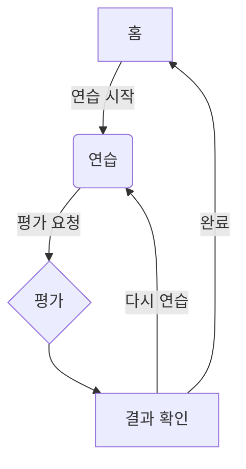

# 사용자 여정 (MVP)

1) 홈(Home)
- 오늘의 연습, 최근 평가, 즐겨찾기 진입
## 핵심 플로우
`홈` → `연습` → `평가` → `결과 확인 및 다음 행동`

2) 연습(Camera/Canvas)
- 가이드 오버레이 확인 → Canvas에 획 입력 → 캡처
### 1. 홈 (Home)
- **행동**: '오늘의 연습' 시작 또는 최근/즐겨찾기 글자 선택
- **컴포넌트**: `HomeScreen.tsx`

3) 평가(Evaluation)
- 점수/세부지표 표시 → 피드백 확인 → 다시 연습/저장
### 2. 연습 (Practice)
- **모드**: Canvas 직접 그리기 또는 카메라 촬영
- **행동**: 가이드라인을 참고하여 글자 입력 후 '평가하기' 버튼 클릭
- **컴포넌트**: `CameraScreen.tsx` (Canvas 통합)

4) 결과 저장
- 로컬 저장(임시) 또는 서버 저장(차기)
### 3. 평가 (Evaluation)
- **행동**: 시스템이 자동으로 사용자의 입력을 분석하고 점수 계산 (2초 이내)
- **컴포넌트**: `EvaluationScreen.tsx`

### 4. 결과 확인 및 다음 행동
- **표시**: 총점, 세부 점수, 피드백 확인
- **선택**:
  - **"다시 연습하기"**: `연습(Practice)` 화면으로 돌아가 같은 글자 재도전
  - **"홈으로"**: `홈(Home)` 화면으로 돌아가기
- **저장**: 결과는 자동으로 로컬에 저장 (`storage.ts` 활용)
- **저장**: 결과는 자동으로 로컬에 저장 (`apps/mobile/src/utils/storage.ts` 활용)

## 상태/전이
- Home → Camera → Evaluation → Home
- 실패 케이스: 카메라 권한 거부, Canvas 미지원

## 예외 케이스
- **카메라 권한 거부**: 권한 요청 안내 메시지 표시
- **Canvas 미지원 브라우저**: 기능 사용 불가 안내 메시지 표시
