# 황자원(黃自元) 간가결구 구십이법(間架結構九十二法)

## 개요
황자원의 간가결구 구십이법은 중국 서예에서 글자의 구조적 배치와 균형을 다루는 체계적인 이론입니다. 각 서법은 특정한 글자 구조의 원리를 제시하며, 서예 학습자들이 올바른 글자 형태를 익힐 수 있도록 돕습니다.

---

## 표지
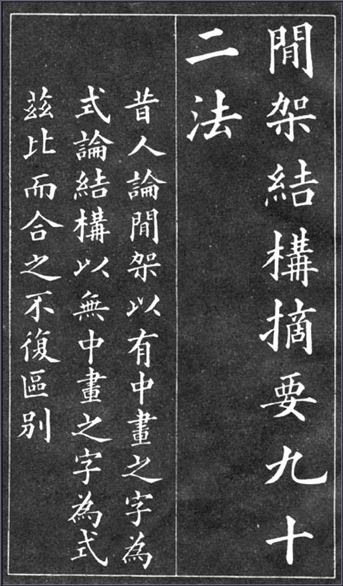

---

## 1-4번 서법: 기본 구조의 원리

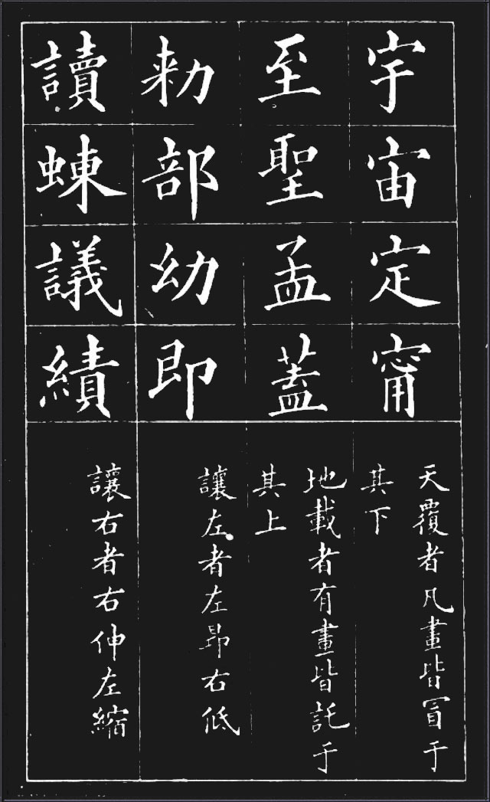

### 1번: 天覆者凡畫皆冒於其下 (천복자범화개모어기하)
**원문:** 하늘이 덮는 자는 모든 획이 모두 그 아래에 가려진다
**설명:** 上面有覆盖笔画的字，下面所有部分都应当被覆盖在其下方，如宀头字等

```
天 (하늘 천)
┌─────┐
│  一  │  ← 상단 횡획이 전체를 덮음
│ 人   │  ← 모든 부분이 그 아래 위치
└─────┘

구조 분해:
   一
   ├── 하늘처럼 전체를 덮는 횡획
   大
   └── 모든 요소가 덮개 아래로

예시: 宇(집 우)
   宀
   ├── 지붕이 모든 것을 덮음
   于
   └── 아래 요소가 보호받음

핵심 원리: 상단의 덮개 역할을 하는 획 아래로 모든 요소가 들어가야 함
```

### 2번: 地載者有畫皆託於其上 (지재자유화개탁어기상)
**원문:** 땅이 받치는 자는 있는 획이 모두 그 위에 의탁한다
**설명:** 下面有承载笔画的字，上面所有部分都应当依托在其上方，如土底字等

```
王 (임금 왕)
│ 一 │  ← 상단 요소들
│ 一 │  
└───┘  ← 하단 횡획이 모든 것을 받침

구조 분해:
   一
   ├── 상단 횡획
   土 
   └── 땅처럼 받치는 하단 구조

예시: 至(이를 지)
   一
   ├── 위의 요소들이
   土
   └── 아래 받침 위에 안착

핵심 원리: 하단의 받침 역할을 하는 획 위에 모든 요소가 올라가야 함
```

### 3번: 讓左者右昂 (양좌자우앙)
**원문:** 왼쪽에 양보하는 자는 오른쪽이 높아진다
**설명:** 左边部分低让的字，右边部分应当高昂，形成呼应关系

```
作 (지을 작)
亻 │ 乍  ← 오른쪽 부분이 더 높이 위치
   │

구조 분해:
   亻
   ├── 왼쪽이 낮게 양보
   乍
   └── 오른쪽이 높게 상승

예시: 佳(아름다울 가)
   亻
   ├── 인변이 공간 양보
   圭
   └── 오른쪽이 위로 솟음
   
핵심 원리: 왼쪽 부분이 공간을 양보하면 오른쪽이 상승
```

### 4번: 讓右者左高 (양우자좌고)
**원문:** 오른쪽에 양보하는 자는 왼쪽이 높다
**설명:** 右边部分低让的字，左边部分应当高起，保持平衡

```
利 (이로울 리)
禾 │ 刂  ← 왼쪽 부분이 더 높이 위치
   │

구조 분해:
   禾
   ├── 왼쪽이 높게 솟음
   刂
   └── 오른쪽이 낮게 양보

예시: 和(화목할 화)
   禾
   ├── 왼쪽 곡식이 높이 자람
   口
   └── 오른쪽이 아래로 양보
   
핵심 원리: 오른쪽 부분이 공간을 양보하면 왼쪽이 상승
```

---

## 5-8번 서법: 길이와 폭의 조화

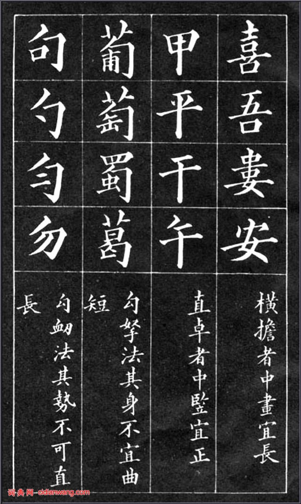

### 5번: 橫擔者中畫宜長 (횡담자중화의장)
**원문:** 가로로 담당하는 자는 중간 획이 마땅히 길어야 한다
**설명:** 有横担作用的字，中间的横画应当写得较长，起到承载作用

```
喜 (기쁠 희)
十 ← 상단
口 ← 중간 부분
┴─┴ ← 하단 횡획이 가장 길게

구조 분해:
   吉
   ├── 상단 부분
   一
   ├── 중간 횡획이 길게 연장
   口
   └── 하단을 안정적으로 지탱

예시: 書(글 서)
   聿
   ├── 상단 붓
   一
   ├── 중간 횡획이 전체를 관통
   日
   └── 하단 받침

핵심 원리: 여러 부분을 가로로 연결하는 중심 획의 연장
```

### 6번: 直筆者中豎宜正 (직필자중수의정)
**원문:** 직선 붓의 자는 중간 세로획이 마땅히 바르다
**설명:** 有中央竖画的字，该竖画应当写得端正垂直，作为字的主干

```
中 (가운데 중)
│
│ ← 중앙 세로획이 완전히 직선
│

구조 분해:
   口
   ├── 사각 틀
   │
   └── 중심을 관통하는 직선

예시: 申(펼 신)
   口
   ├── 외곽 틀
   │
   └── 중앙을 꿰뚫는 수직선

핵심 원리: 전체 글자의 중심축 역할을 하는 세로획의 정확성
```

### 7번: 勾拏法 (구나법)
**원문:** 갈고리로 끌어당기는 법
**설명:** 钩画要有力度，能够拉住整个字的结构，不可软弱无力

```
勾 (갈고리 구)
勹 ← 감싸는 형태의 구조
│ ○ ← 내부 요소를 감쌈
└─

구조 분해:
   勹
   ├── 갈고리로 감싸는 외곽
   ㄱ
   └── 안으로 끌어당기는 형태

예시: 句(구 구)
   勹
   ├── 감싸는 갈고리
   口
   └── 보호받는 내부

핵심 원리: 곡선적 포용과 직선적 지지의 결합
```

### 8번: 勾努法 (구노법)
**원문:** 갈고리로 힘을 주는 법
**설명:** 钩画要努力向上，体现出力量感和向上的精神

```
刀 (칼 도)
│ ← 직선적 힘
└─ ← 갈고리 형태의 마무리

구조 분해:
   丿
   ├── 날카로운 시작
   └┐
   └── 힘있는 갈고리 마무리

예시: 勺(국자 작)
   勹
   ├── 부드러운 곡선
   丶
   └── 힘있는 점으로 마무리

핵심 원리: 강직함과 유연함의 조화
```

---

## 9-12번 서법: 종횡의 균형

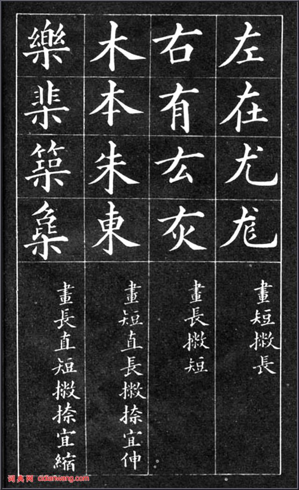

### 9번: 縱有行 (종유행)
**원문:** 세로에는 행렬이 있다
**설명:** 竖画之间要保持一定的行列关系，使字体纵向排列有序

```
樂 (즐거울 락)
白 ← 각 부분이 세로로 정렬
木 ← 중심축을 따라 배치

구조 분해:
   白
   ├── 상단 백 부분
   │  
   木
   └── 하단 목 부분이 수직 정렬

예시: 書(글 서)
   聿
   ├── 상단
   │
   日
   └── 하단이 수직선 상 정렬
   
핵심 원리: 세로 방향의 일관된 정렬과 균형
```

### 10번: 橫有列 (횡유열)
**원문:** 가로에는 열이 있다
**설명:** 横画之间要保持一定的列距关系，使字体横向排列整齐

```
무 (없을 무)
一 ← 가로선들이 수평 유지
一 ← 각 횡획의 평행 관계

구조 분해:
   一
   ├── 상단 횡선
   一
   ├── 중간 횡선
   一
   └── 하단 횡선 모두 평행

예시: 三(셋 삼)
   一
   ├── 짧은 횡선
   一
   ├── 중간 길이
   一
   └── 가장 긴 횡선
   
핵심 원리: 가로 방향의 수평적 질서 유지
```

### 11번: 勾斡法 (구알법)
**원문:** 갈고리로 돌리는 법
**설명:** 钩画要有旋转的势态，体现出动感和力度

```
建 (세울 건)
廴 ← 감싸면서 돌리는 형태
│

구조 분해:
   艷
   ├── 위에서 시작하여
   廴
   └── 갈고리로 돌아 감싸며 끝남

예시: 迯(달릴 진)
   辛
   ├── 내부 요소
   辶
   └── 회전하며 감싸는 형태
   
핵심 원리: 곡선적 움직임을 통한 역동성 표현
```

### 12번: 勾裹法 (구과법)
**원문:** 갈고리로 감싸는 법
**설명:** 钩画要能包裹内部笔画，形成包容感

```
包 (쌀 포)
勹 ← 완전히 감싸는 구조
○ ← 내부 요소를 보호

구조 분해:
   勹
   ├── 외부를 감싸는 틀
   巳
   └── 내부를 완전히 포용

예시: 匃(경단 홈)
   勹
   ├── 감싸는 외곽
   匕
   └── 보호받는 중심
   
핵심 원리: 포용적 구조를 통한 안정감 조성
```

---

## 13-16번 서법: 상하의 호응

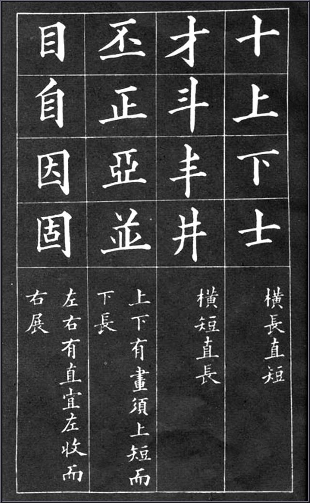

### 13번: 上占地步寬 (상점지보관)
**원문:** 위가 차지하는 땅이 넓다
**설명:** 上部结构占据较大空间的字，下部应当收缩

```
宇 (집 우)
宀 ← 상단이 넓게 차지
于 ← 하단은 상대적으로 좁음

구조 분해:
   宀
   ├── 넓은 지붕이 전체를 덮음
   于
   └── 좀 더 좁은 공간에 안착

예시: 安(편안할 안)
   宀
   ├── 큰 지붕
   女
   └── 작은 하부
   
핵심 원리: 상하 비례에서 상단의 우세함
```

### 14번: 下佔地步寬 (하점지보관)
**원문:** 아래가 차지하는 땅이 넓다
**설명:** 下部结构占据较大空间的字，上部应当收缩

```
至 (이를 지)
一 ← 상단은 좁음
土 ← 하단이 넓게 차지

구조 분해:
   一
   ├── 짧은 상단
   土
   └── 넓게 퍼진 하단 받침

예시: 志(뜻 지)
   士
   ├── 작은 상부
   心
   └── 큰 하부
   
핵심 원리: 상하 비례에서 하단의 우세함
```

### 15번: 左佔地步寬 (좌점지보관)
**원문:** 왼쪽이 차지하는 땅이 넓다
**설명:** 左部结构占据较大空间的字，右部应当收缩

```
影 (그림자 영)
景 ← 왼쪽 부분이 넓음
彡 ← 오른쪽은 좁음

구조 분해:
   景
   ├── 넓은 왼쪽 경 부분
   彡
   └── 좁은 오른쪽 삼초변

예시: 歌(노래 가)
   可
   ├── 큰 왼쪽
   欠
   └── 작은 오른쪽
   
핵심 원리: 좌우 비례에서 좌측의 우세함
```

### 16번: 右佔地步寬 (우점지보관)
**원문:** 오른쪽이 차지하는 땅이 넓다
**설명:** 右部结构占据较大空间的字，左部应当收缩

```
郎 (사내 랑)
良 ← 왼쪽은 좁음
阝 ← 오른쪽이 넓게 차지

구조 분해:
   良
   ├── 좁은 왼쪽
   阝
   └── 넓은 오른쪽 이변

예시: 都(도시 도)
   者
   ├── 작은 왼쪽
   阝
   └── 큰 오른쪽
   
핵심 원리: 좌우 비례에서 우측의 우세함
```

---

## 17-20번 서법: 조밀과 개방

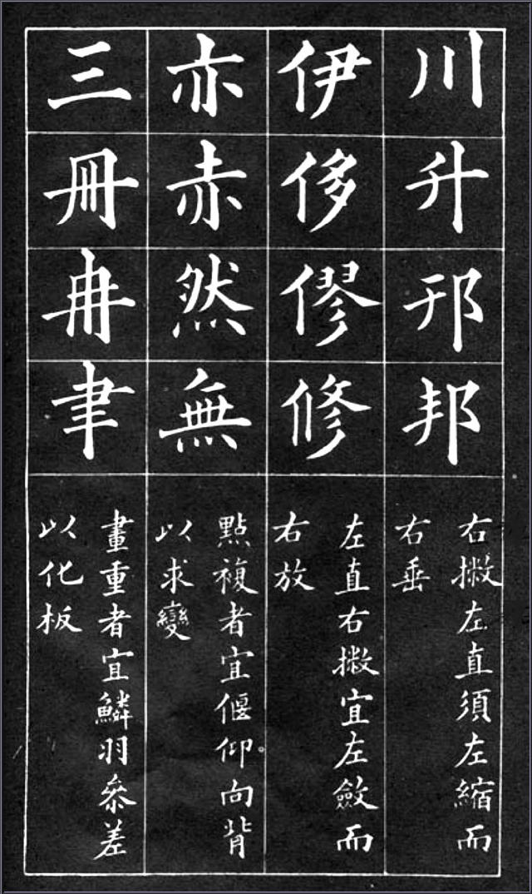

### 17번: 川升小異 (천승소이)
**원문:** 川자와 升자는 작은 차이가 있다
**설명:** 形似的字要注意细微差别，避免混淆

```
川 (내 천)     升 (오를 승)
│││           廾
│││           │

구조 분해:
川:           升:
 │││          ─┬─
 ├┼┤          ││
 평행선       교차점이 있음

예시: 州(고을 주) vs 巡(순찰 순)
   州: 세 개의 독립적 세로선
   巡: 연결된 획의 흐름
               
핵심 원리: 유사한 구조에서도 세밀한 차이점 구별
```

### 18번: 己已小異 (기이소이)
**원문:** 己자와 已자는 작은 차이가 있다
**설명:** 相似字形的细微差别决定不同含义，须仔细区分

```
己 (몸 기)     已 (이미 이)
己             已

구조 분해:
己:           已:
 ┌─┐          ┌─┐
 │ └──       │ │
 └───        └─┴
 열린 구조    닫힌 구조

예시: 巳(뱀 사)
   己과 已의 중간 형태
   각각 미세한 차이로 구분
               
핵심 원리: 미세한 형태 변화가 만드는 의미 차이
```

### 19번: 修短合度 (수단합도)
**원문:** 길고 짧음이 법도에 합당하다
**설명:** 笔画的长短要符合字体结构的需要，保持适当比例

```
修 (닦을 수)
亻 ← 짧은 부분
修 ← 긴 부분이 조화

구조 분해:
   亻
   ├── 짧고 간결한 인변
   攸
   └── 길고 복잡한 오른쪽

예시: 短(짧을 단)
   矢
   ├── 짧은 화살
   豆
   └── 적절한 길이의 콩
   
핵심 원리: 각 부분의 길이가 전체와 조화를 이룸
```

### 20번: 燥潤合度 (조윤합도)
**원문:** 마르고 윤택함이 법도에 합당하다
**설명:** 笔画的枯润要适度，既不过于干枯也不过于湿润

```
燥 (마를 조)   潤 (윤택할 윤)
火 + 燥       氵+ 閏

구조 분해:
燥:           潤:
 火            氵
 ├── 불(마름)  ├── 물(촉촉함)
 躁           閏
 └── 발건     └── 엔달

예시: 건조한 성질과 촉촉한 성질의 조화
               
핵심 원리: 상반된 성질의 요소들이 균형을 이룸
```

---

## 21-24번 서법: 자세와 기세

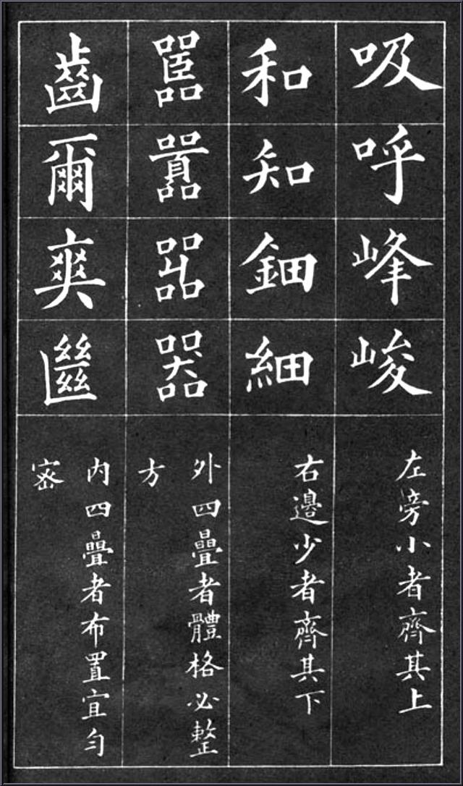

### 21번: 向背法 (향배법)
**원문:** 향하고 등지는 법
**설명:** 字的各部分要有向背关系，形成呼应和对比

```
聰 (총명할 총)
耳 ← 귀 부분이 앞을 향함
聰 ← 전체적인 방향성

구조 분해:
   耳
   ├── 왼쪽 귀(앞향)
   總
   └── 오른쪽 총(뒤향)

예시: 背(등 배)
   北
   ├── 서로 등지는 부분
   月
   └── 아래쪽 달 부분
   
핵심 원리: 글자 구성 요소들의 방향성과 조화
```

### 22번: 偏正法 (편정법)
**원문:** 기울고 바른 법
**설명:** 偏旁和正体要相互配合，斜正相得益彰

```
政 (정치 정)
正 ← 바른 부분
攵 ← 기울어진 부분

구조 분해:
   正
   ├── 반듯한 정사각형
   攵
   └── 비스듬한 효자변

예시: 故(연고 고)
   古
   ├── 바른 고 부분
   攵
   └── 기울어진 복문
   
핵심 원리: 대비를 통한 균형감 조성
```

### 23번: 向勢法 (향세법)
**원문:** 방향과 세력의 법
**설명:** 字势要有明确的方向感，体现出内在的力量

```
勢 (세력 세)
埶 ← 상승하는 기세
力 ← 힘의 방향성

구조 분해:
   埶
   ├── 위로 향하는 기운
   力
   └── 아래에서 받쳐주는 힘

예시: 熱(뜨거울 열)
   埶
   ├── 열기가 상승
   灬
   └── 불이 타오름
   
핵심 원리: 동적 에너지의 방향성 표현
```

### 24번: 朝揖法 (조읍법)
**원문:** 조회하고 읍하는 법
**설명:** 字的各部分要有礼让相待的关系，如朝会拱手

```
朝 (아침 조)
十 ← 상부에서 하부로
月 ← 공손한 자세

구조 분해:
   十日
   ├── 해가 뜨는 아침
   月
   └── 달처럼 공손히 인사

예시: 揖(공손할 읍)
   手
   ├── 두 손을 모아
   揖
   └── 공손히 인사하는 형태
   
핵심 원리: 예의와 질서의 시각적 표현
```

---

## 25-28번 서법: 기울기와 균형

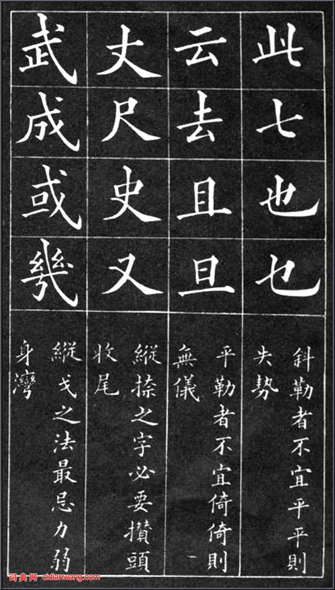

### 25번: 斜勒法 (사륵법)
**원문:** 비스듬히 당기는 법
**설명:** 横画要有适当的倾斜角度，不可完全水平

```
勒 (굴레 륵)
革 ← 기울어진 형태
力 ← 힘의 균형

구조 분해:
   革
   ├── 가죽이 비스듬히 펼쳐짐
   力
   └── 아래에서 힘으로 지탱

예시: 劉(유 류)
   刂
   ├── 기울어진 좌측 부분
   刂
   └── 칼로 베는 동작의 기울기
   
핵심 원리: 기울어진 요소를 통한 역동성
```

### 26번: 平勒法 (평륵법)
**원문:** 평평하게 당기는 법
**설명:** 某些横画要保持水平，形成稳定感

```
平 (평평할 평)
一 ← 완전한 수평
干 ← 균형잡힌 구조

구조 분해:
   一
   ├── 완벽한 수평선
   干
   └── 수직선과 수평선의 균형

예시: 干(간섭할 간)
   一
   ├── 평평한 상단 횡획
   十
   └── 중심을 관통하는 수직선
   
핵심 원리: 수평적 안정감 추구
```

### 27번: 縱捺法 (종날법)
**원문:** 세로로 삐치는 법
**설명:** 纵向的捺画要有力度和伸展感

```
大 (클 대)
一 ← 횡획
人 ← 세로 삐침이 중심

구조 분해:
   一
   ├── 상단 횡획이 덮음
   ノ
   ├── 왼쪽에서 아래로 삐침
   ㇏
   └── 오른쪽으로 퍼지는 삐침

예시: 人(사람 인)
   ノ
   ├── 사람의 왼쪽 다리
   ㇏
   └── 안정감 있는 오른쪽 다리
   
핵심 원리: 수직 방향의 강조점 배치
```

### 28번: 縱戈法 (종과법)
**원문:** 세로로 창을 세우는 법
**설명:** 纵向的戈钩要挺直有力，如同竖立的长戈

```
戈 (창 과)
一 ← 횡획
戈 ← 세로 창 형태

구조 분해:
   一
   ├── 창날의 가로 부분
   亅
   ├── 창 자루의 수직 부분
   丶
   └── 창 끝의 날카로운 점

예시: 我(나 아)
   手
   ├── 손이 창을 잡는 형태
   戈
   └── 세로로 든 창의 모습
   
핵심 원리: 날카로운 수직 요소의 활용
```

---

## 29-32번 서법: 갈고리와 구조

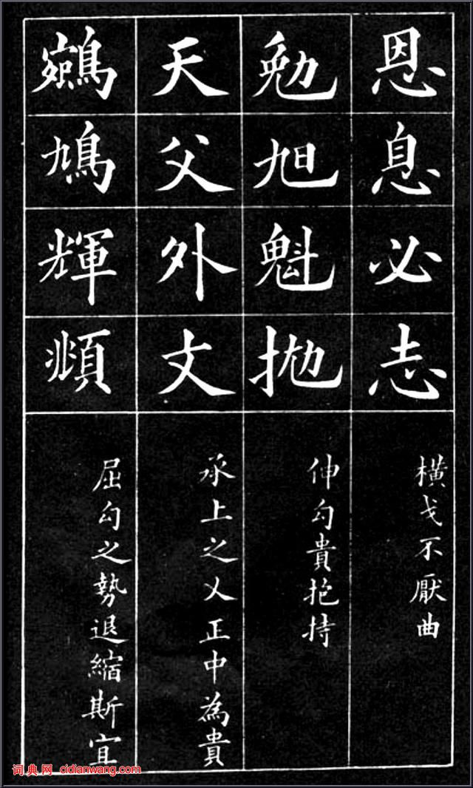

### 29번: 橫戈法 (횡과법)
**원문:** 가로로 창을 놓는 법
**설명:** 横向的戈钩要平稳有力，如同横置的兵器

```
武 (무술 무)
止 ← 기본 구조
戈 ← 가로 창 형태

구조 분해:
   止
   ├── 발이 멈춘 모습
   戈
   └── 가로로 든 창의 형태

예시: 式(식 식)
   弋
   ├── 가로로 날아가는 화살
   工
   └── 기본 틀로 받침
   
핵심 원리: 수평적 날카로움의 표현
```

### 30번: 伸勾法 (신구법)
**원문:** 뻗어나가는 갈고리의 법
**설명:** 钩画要有伸展的势态，不可拘谨收缩

```
勾 (갈고리 구)
勹 ← 뻗어나가는 형태
勾 ← 갈고리의 연장

구조 분해:
   勹
   ├── 감싸면서 뻗어나가는 획
   厶
   └── 아래로 내려와 갈고리 형성

예시: 句(구 구)
   勹
   ├── 위에서 시작해 감싸며
   口
   └── 아래 구멍을 둘러쌈
   
핵심 원리: 확장과 연결의 역동성
```

### 31번: 承上法 (승상법)
**원문:** 위를 받들어 올리는 법
**설명:** 下部结构要能够稳固地承托上部，形成支撑感

```
承 (받들 승)
手 ← 받드는 손
承 ← 위를 떠받치는 구조

구조 분해:
   ㄷ
   ├── 위에서 내려오는 압력
   三
   ├── 세 개의 손가락으로 받침
   ㅣ
   └── 아래에서 위로 버티는 힘

예시: 丞(도울 승)
   卅
   ├── 상부의 무게
   手
   └── 아래에서 떠받드는 손
   
핵심 원리: 하부에서 상부로의 지지
```

### 32번: 呈勾法 (정구법)
**원문:** 드러내어 보이는 갈고리의 법
**설명:** 钩画要明显突出，形成视觉焦点

```
呈 (드러낼 정)
口 ← 기본 틀
王 ← 내부 구조의 표현

구조 분해:
   口
   ├── 외부를 감싸는 틀
   王
   └── 내부에 명확히 드러난 구조

예시: 程(법도 정)
   禾
   ├── 곡식이 자라는 과정
   呈
   └── 성장 상태를 드러냄
   
핵심 원리: 내부 요소의 명확한 표현
```

---

## 33-36번 서법: 복합 구조

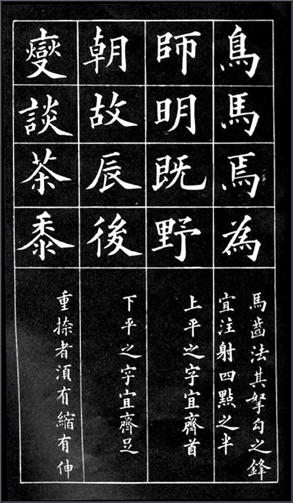

### 33번: 三合法 (삼합법)
**원문:** 세 부분이 합쳐지는 법
**설명:** 三个相同部件的组合要有主次变化，不可完全相同

```
品 (품격 품)
口 ← 상단 하나
口口 ← 하단 둘의 조화

구조 분해:
   口
   ├── 상단 중앙에 하나
   口
   ├── 하단 좌측에 하나  
   口
   └── 하단 우측에 하나

예시: 晶(수정 정)
   日
   ├── 상단 태양
   日
   ├── 좌하단 반짝임
   日  
   └── 우하단 광채
   
핵심 원리: 3개 요소의 균형잡힌 배치
```

### 34번: 二段法 (이단법)
**원문:** 두 단계로 나누는 법
**설명:** 上下两段式结构要注意比例和呼应关系

```
昌 (창성할 창)
日 ← 상단
日 ← 하단의 균형

구조 분해:
   日
   ├── 상단 해
   日
   └── 하단 해가 완벽히 균형

예시: 炎(불꽃 염)
   火
   ├── 상단 불꽃
   火
   └── 하단 불꽃이 대칭
   
핵심 원리: 상하 2단 구조의 균형
```

### 35번: 三疊法 (삼첩법)
**원문:** 세 겹으로 쌓는 법
**설명:** 三层叠加的结构要注意层次感和稳定性

```
森 (숲 삼)
木 ← 상단
木木 ← 하단 두 개

구조 분해:
   木
   ├── 상단 중앙의 나무
   木
   ├── 하단 좌측 나무
   木
   └── 하단 우측 나무가 숲 이룸

예시: 磊(바위 뢰)
   石
   ├── 상단 바위
   石
   ├── 좌하단 바위
   石
   └── 우하단 바위가 쌓임
   
핵심 원리: 3층 구조의 안정성
```

### 36번: 四疊法 (사첩법)
**원문:** 네 겹으로 쌓는 법
**설명:** 四个相同部件的组合要避免呆板，保持灵动

```
燚 (불꽃 예)
火火 ← 상단 둘
火火 ← 하단 둘

구조 분해:
   火
   ├── 좌상단 불꽃
   火
   ├── 우상단 불꽃
   火
   ├── 좌하단 불꽃
   火
   └── 우하단 불꽃이 타오름

예시: 㗊(많을 철)
   吅
   ├── 상단 두 입
   吅
   └── 하단 두 입으로 시끄러움
   
핵심 원리: 4개 요소의 균등 배치
```

---

## 37-40번 서법: 포위와 내재

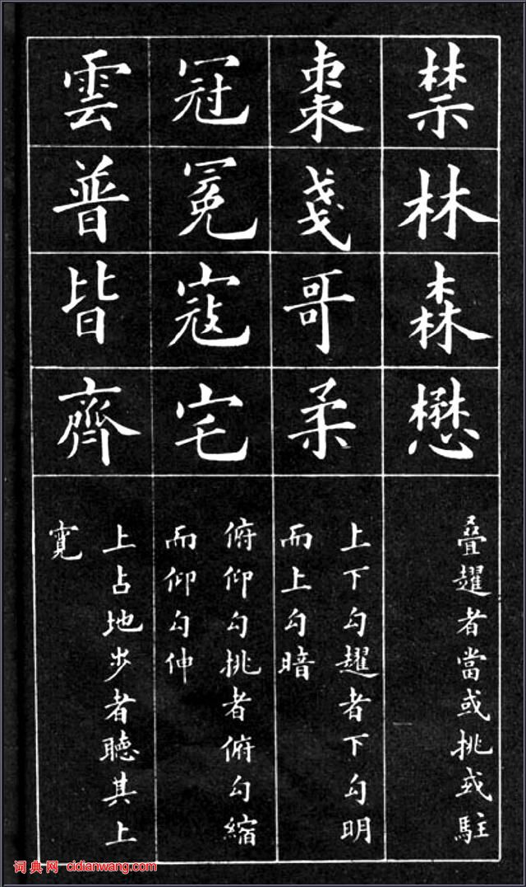

### 37번: 重疊宜偏 (중첩의편)
**원문:** 중첩할 때는 마땅히 기울어야 한다
**설명:** 重叠的部件要有偏斜变化，避免完全重复

```
疊 (겹칠 첩)
重重 ← 완전히 겹치지 않고
      ← 약간 어긋나게 배치

구조 분해:
   重
   ├── 첫 번째 무거운 것이 중앙에
   重
   └── 두 번째가 약간 옆으로 치우쳐

예시: 競(경쟁할 경)
   立
   ├── 왼쪽 사람이 서고
   立
   └── 오른쪽 사람이 약간 어긋나 섬
   
핵심 원리: 완전한 대칭보다는 미묘한 변화 추구
```

### 38번: 重疊宜齊 (중첩의제)
**원문:** 중첩할 때는 마땅히 가지런해야 한다
**설명:** 某些重叠部件需要整齐对齐，形成规整感

```
齊 (가지런할 제)
齊齊 ← 정확한 정렬
    ← 일치된 간격

구조 분해:
   齊
   ├── 첫 번째 요소가 기준선에
   齊
   └── 두 번째 요소도 같은 선상에

예시: 並(나란할 병)
   立
   ├── 왼쪽 사람이 정렬
   立
   └── 오른쪽 사람도 같은 높이
   
핵심 원리: 반복 요소들의 일관된 정렬
```

### 39번: 堆疊宜正 (퇴첩의정)
**원문:** 쌓아올릴 때는 마땅히 바르게 해야 한다
**설명:** 堆叠结构要保持垂直对正，不可歪斜

```
塔 (탑 탑)
口 ← 각 층이 정확히
口 ← 중심축에 맞춰
口 ← 수직으로 쌓임

구조 분해:
   口
   ├── 최상층이 중심에
   口
   ├── 중간층도 정중앙에
   口
   └── 하층도 일직선상에

예시: 器(그릇 기)
   口
   ├── 위쪽 입구
   犬
   ├── 중간 몸통
   口
   └── 아래 바닥이 일치
   
핵심 원리: 수직 구조의 정확한 중심축 유지
```

### 40번: 積疊宜變 (적첩의변)
**원문:** 쌓을 때는 마땅히 변화가 있어야 한다
**설명:** 积叠的部件要有大小、疏密的变化，避免单调

```
積 (쌓을 적)
禾 ← 각 부분이 
積 ← 미묘하게 다른 형태

구조 분해:
   禾
   ├── 곡식이 자연스럽게 자라며
   責
   └── 쌓이면서 다양한 형태를 가짐

예시: 累(쌓을 루)
   田
   ├── 밭이 계단식으로
   累
   └── 높이에 따라 크기 변화
   
핵심 원리: 반복 속에서도 변화와 생동감 유지
```

---

## 41-44번 서법: 길이와 비례


### 41번: 字有長短 (자유장단)
**원문:** 글자에는 길고 짧음이 있다
**설명:** 字体本有长短之别，不可强求一律

```
長 (길 장)     短 (짧을 단)
長長長         矢石

구조 분해:
長:           短:
 ╭──┐          矢
 │  │          ├── 화살의 길이 (짧음)
 │  │          豆
 └──┘          └── 콩의 모양 (아담함)
 세로로 긴 모양  위아래 압축된 형태

예시: 車(수레 거) vs 扁(편편할 편)
   車: 세로로 긴 수레
   扁: 옆으로 납작한 형태
             
핵심 원리: 글자마다 고유한 비례감 존재
```

### 42번: 字有大小 (자유대소)
**원문:** 글자에는 크고 작음이 있다
**설명:** 字体本有大小之别，应当顺其自然

```
大 (클 대)     小 (작을 소)
大大大         小

구조 분해:
大:           小:
 ╱─╲          ∣
╱   ╲         ∣
팔을 벌린 큰 모습  작은 점들의 모임

예시: 廣(넓을 광) vs 微(작을 미)
   廣: 집 안이 넓고 큰 공간
   微: 아주 작고 미세한 것
             
핵심 원리: 글자 고유의 크기감 인정
```

### 43번: 字有寬窄 (자유관착)
**원문:** 글자에는 넓고 좁음이 있다
**설명:** 字体本有宽窄之别，要依其本性书写

```
寬 (넓을 관)   窄 (좁을 착)
寬寬寬         穴八

구조 분해:
寬:           窄:
┌──────┐      ∧
│      │      │
│      │      ∣
└──────┘      작은 구멍
가로가 넓은 형태   위아래로 긴 형태

예시: 四(넷 사) vs 山(산 산)
   四: 네모나게 넓은 공간
   山: 세로로 높고 좁은 모습
             
핵심 원리: 글자의 폭에 따른 적절한 조정
```

### 44번: 字有疏密 (자유소밀)
**원문:** 글자에는 성기고 빽빽함이 있다
**설명:** 字体本有疏密之别，要因字制宜

```
疏 (성글 소)   密 (빽빽할 밀)
疏 疏          密密密

구조 분해:
疏:           密:
 ∣ ∣           ||||
 ∣ ∣           ||||
 ∣ ∣           ||||
띄엄띄엄 배치    빽빽하게 배치

예시: 川(내 천) vs 齒(이 치)
   川: 세 줄기가 떨어져 흐름
   齒: 이빨이 빽빽하게 배열
             
핵심 원리: 획의 밀도에 따른 공간 조절
```

---

## 45-48번 서법: 기세와 움직임

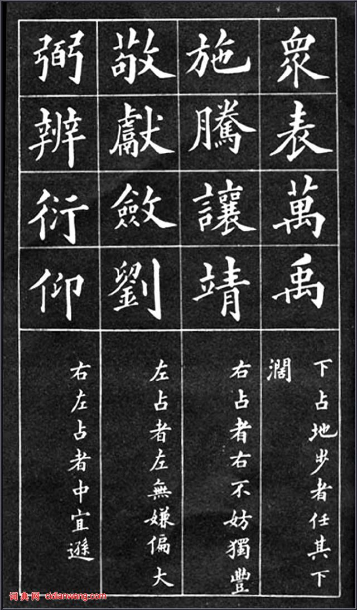

### 45번: 臨寫宜肥 (임사의비)
**원문:** 임서할 때는 마땅히 살찌게 해야 한다
**설명:** 临写时笔画可以略肥，体现丰满之美

```
肥 (살찔 비)
月 + 巴 ← 풍만한 형태
         ← 여유있는 굵기

구조 분해:
   月
   ├── 달처럼 둥글고 풍만한 형태
   巴
   └── 살이 붙어 풍성함

예시: 豐(풍성할 풍)
   豆
   ├── 위의 큰 부분
   豊
   └── 아래 가득한 모습
   
핵심 원리: 임서 시 원본보다 약간 굵게 표현
```

### 46번: 臨寫宜瘦 (임사의수)
**원문:** 임서할 때는 마땅히 마르게 해야 한다
**설명:** 临写时笔画可以略瘦，体现清劲之美

```
瘦 (마를 수)
疒 + 叟 ← 간결한 형태
        ← 절제된 굵기

구조 분해:
   疒
   ├── 병으로 야윈 상태
   叟
   └── 늙어서 마른 노인

예시: 細(가늘 세)
   糸
   ├── 실처럼 가는 부분
   田
   └── 작고 정리된 모습
   
핵심 원리: 원본의 정신을 살리되 간결하게
```

### 47번: 轉換宜活 (전환의활)
**원문:** 전환할 때는 마땅히 활발해야 한다
**설명:** 笔画转折处要灵活自然，不可僵硬

```
活 (살 활)
氵+ 舌 ← 유연한 변화
       ← 자연스러운 연결

구조 분해:
   氵
   ├── 물처럼 흘러가는 움직임
   舌
   └── 혀처럼 유연한 변화

예시: 流(흐를 류)
   氵
   ├── 물의 흐름
   流
   └── 구불구불 자연스럽게
   
핵심 원리: 방향 전환 시 경직되지 않는 자연스러움
```

### 48번: 轉換宜穩 (전환의은)
**원문:** 전환할 때는 마땅히 안정되어야 한다
**설명:** 笔画转折处要稳重有力，保持结构稳定

```
穩 (안정할 은)
禾 + 隱 ← 견고한 기반
        ← 흔들리지 않는 중심

구조 분해:
   禾
   ├── 곡식이 뿌리내린 안정감
   隱
   └── 숨겨진 견고한 지지

예시: 安(편안할 안)
   宀
   ├── 집의 안정적 지붕
   女
   └── 평온히 앉은 여성
   
핵심 원리: 변화 속에서도 중심축 유지
```

---

## 49-52번 서법: 기울기와 자세

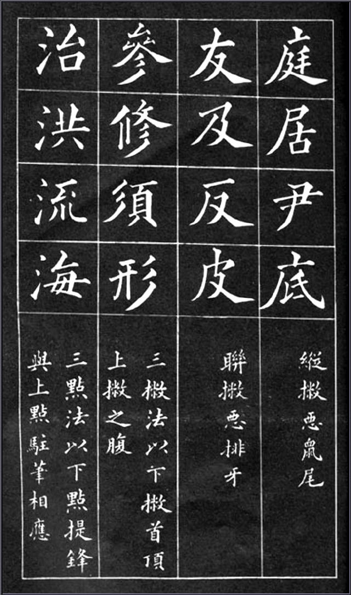

### 49번: 相讓法 (상양법)
**원문:** 서로 양보하는 법
**설명:** 字的各部分要相互谦让，避免拥挤冲突

```
讓 (양보할 양)
言 + 襄 ← 두 부분이
        ← 서로 공간 양보

구조 분해:
   言
   ├── 왼쪽이 말하며 공간 양보
   襄
   └── 오른쪽이 받아들이며 조화

예시: 謙(겸손할 겸)
   言
   ├── 말을 조심스럽게
   兼
   └── 두루 배려하는 마음
   
핵심 원리: 구성 요소들의 상호 배려
```

### 50번: 相就法 (상취법)
**원문:** 서로 나아가는 법
**설명:** 字的各部分要相互靠拢，形成凝聚感

```
就 (나아갈 취)
京 + 尤 ← 두 부분이
        ← 서로를 향해 움직임

구조 분해:
   京
   ├── 높은 곳에서 내려와
   尤
   └── 특별한 것을 향해 다가감

예시: 趨(달려갈 추)
   走
   ├── 달려가는 발
   芻
   └── 목표를 향한 움직임
   
핵심 원리: 요소들 간의 적극적 상호작용
```

### 51번: 相背法 (상배법)
**원문:** 서로 등지는 법
**설명:** 字的各部分要有背离趋势，形成张力

```
背 (등 배)
北 + 月 ← 두 부분이
        ← 반대 방향을 향함

구조 분해:
   北
   ├── 북쪽을 향해 등을 돌리고
   月
   └── 달이 뒤쪽에서 비춤

예시: 乖(어긋날 괴)
   千
   ├── 왼쪽으로 향하고
   乚
   └── 오른쪽으로 어긋남
   
핵심 원리: 대조를 통한 균형감 조성
```

### 52번: 相向法 (상향법)
**원문:** 서로 향하는 법
**설명:** 字的各部分要相向而对，形成向心力

```
向 (향할 향)
丿 + 口 ← 두 부분이
        ← 서로를 마주봄

구조 분해:
   丿
   ├── 비스듬히 향하는 방향
   口
   └── 정면으로 마주보는 입

예시: 對(대할 대)
   文
   ├── 왼쪽 문양이
   寸
   └── 오른쪽을 향해 마주봄
   
핵심 원리: 내향적 집중력 강화
```

---

## 53-56번 서법: 기점과 종점

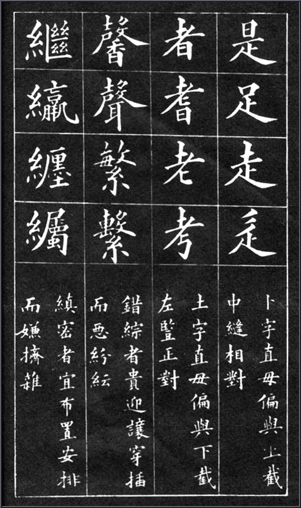

### 53번: 起筆宜重 (기필의중)
**원문:** 시작 붓질은 마땅히 무거워야 한다
**설명:** 起笔要有力度，形成稳重的开端

```
重 (무거울 중)
千 + 里 ← 시작점이 뚜렷
        ← 확실한 기점

구조 분해:
   千
   ├── 위에서 힘있게 시작
   里
   └── 아래까지 무게감 있게 내려옴

예시: 筆(붓 필)
   竹
   ├── 대나무 붓대의 시작
   聿
   └── 묵직한 붓 끝
   
핵심 원리: 명확한 시작점으로 글자의 기세 확립
```

### 54번: 收筆宜輕 (수필의경)
**원문:** 마무리 붓질은 마땅히 가벼워야 한다
**설명:** 收笔要轻盈自然，如鸟之尾羽

```
輕 (가벼울 경)
車 + 巠 ← 마무리가 부드러움
        ← 자연스러운 종료

구조 분해:
   車
   ├── 수레가 천천히 멈추며
   巠
   └── 실처럼 가볍게 마무리

예시: 羽(깃털 우)
   羽
   ├── 왼쪽 깃털이 가볍게
   羽
   └── 오른쪽도 부드럽게 끝남
   
핵심 원리: 부드러운 마무리로 여운 남기기
```

### 55번: 承接宜順 (승접의순)
**원문:** 이어받음은 마땅히 순조로워야 한다
**설명:** 笔画承接要顺畅自然，如水流不断

```
順 (순할 순)
川 + 頁 ← 자연스러운 흐름
        ← 매끄러운 연결

구조 분해:
   川
   ├── 강물처럼 자연스럽게 흘러
   頁
   └── 다음 부분으로 순조롭게 이어짐

예시: 連(이을 련)
   車
   ├── 수레가 계속 굴러가며
   連
   └── 끊어지지 않고 연결됨
   
핵심 원리: 획과 획 사이의 자연스러운 연결
```

### 56번: 呼應宜神 (호응의신)
**원문:** 호응은 마땅히 신령스러워야 한다
**설명:** 笔画之间的呼应要有神韵，不只形似更要神似

```
神 (신령 신)
示 + 申 ← 영적인 교감
        ← 깊은 상호작용

구조 분해:
   示
   ├── 신령이 보여주는 계시
   申
   └── 인간이 펼쳐내는 응답

예시: 感(느낄 감)
   咸
   ├── 모든 것이 함께 느끼고
   心
   └── 마음으로 깊이 감응함
   
핵심 원리: 단순한 형태를 넘어선 정신적 소통
```

---

## 57-60번 서법: 공간과 여백

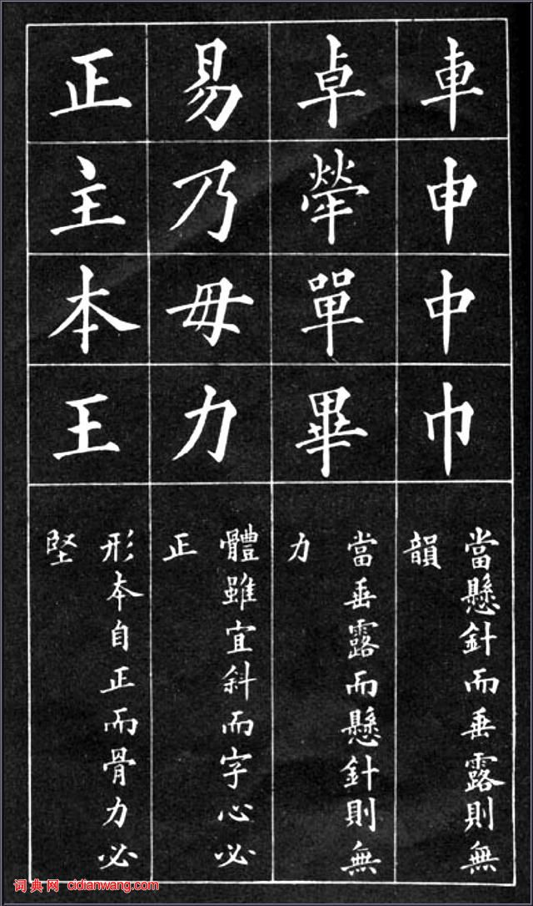

### 57번: 布白均勻 (포백균균)
**원문:** 여백 배치가 고르고 균등하다
**설명:** 字内空白要分布均匀，避免疏密失调

```
均 (고를 균)
土 + 匀 ← 고른 분배
        ← 일정한 간격

구조 분해:
   土
   ├── 땅처럼 평평하고 고른 기반
   匀
   └── 균등하게 나누어진 공간

예시: 田(밭 전)
   □
   ├── 네 구획이 모두
   □
   └── 같은 크기로 분할
   
핵심 원리: 글자 내부 공간의 균등한 분배
```

### 58번: 布白疏密 (포백소밀)
**원문:** 여백 배치에 성기고 빽빽함이 있다
**설명:** 空白分布要有疏密变化，形成节奏感

```
疏 (성글 소)   密 (빽빽할 밀)
疏  疏         密密密

구조 분해:
疏:           密:
 ∣ ∣ ∣         ||||||||
넓은 간격      촘촘한 간격

예시: 疎(소통할 소) vs 密(빽빽할 밀)
   疎: 강이 성기게 흘러
   密: 실이 빽빽하게 짜여짐
             
핵심 원리: 의도적인 여백의 강약 조절
```

### 59번: 筆畫相稱 (필화상칭)
**원문:** 붓획이 서로 칭하여 맞다
**설명:** 笔画粗细要相称，保持整体协调

```
稱 (칭할 칭)
禾 + 爯 ← 좌우 균형
        ← 조화로운 비례

구조 분해:
   禾
   ├── 왼쪽 곡식이 자라고
   爯
   └── 오른쪽 손이 균형잡힌 힘

예시: 相(서로 상)
   木
   ├── 나무의 중심축
   目
   └── 눈이 바라보는 균형
   
핵심 원리: 모든 획들의 상호 균형감
```

### 60번: 筆畫相配 (필화상배)
**원문:** 붓획이 서로 짝을 이룬다
**설명:** 笔画之间要相互配合，形成和谐关系

```
配 (짝 배)
酉 + 己 ← 서로 다른 요소들의
        ← 완벽한 조화

구조 분해:
   酉
   ├── 술통처럼 둥근 형태
   己
   └── 자기처럼 각진 형태가 조화

예시: 調(고를 조)
   言
   ├── 말의 직선적 요소
   周
   └── 둘러싸는 곡선적 요소
   
핵심 원리: 이질적 요소들의 조화로운 결합
```

---

## 61-64번 서법: 세부 기법

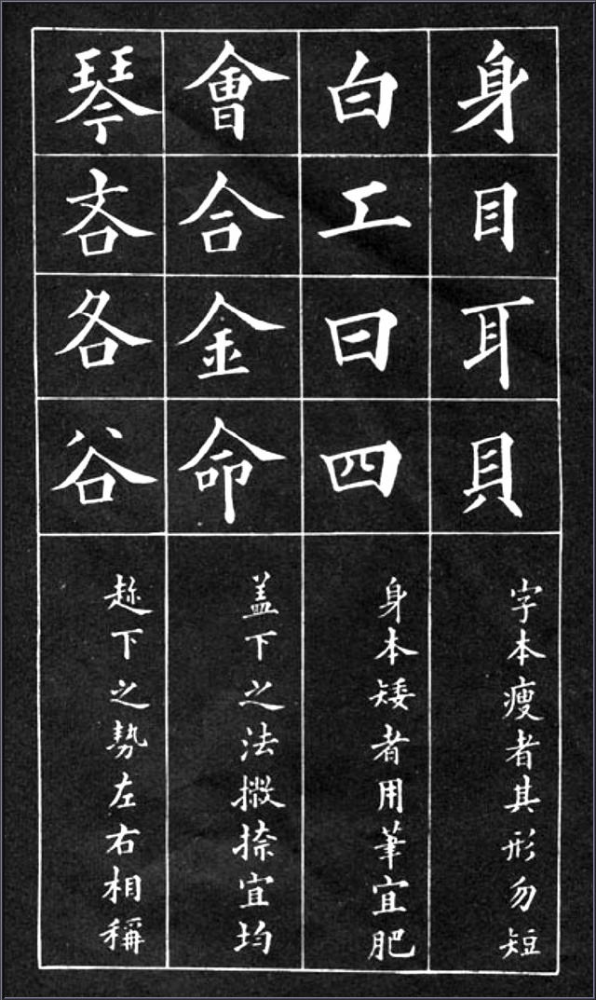

### 61번: 點畫呼應 (점화호응)
**원문:** 점획이 서로 호응한다
**설명:** 点画之间要相互呼应，形成整体感

```
呼 (부를 호)
口 + 乎 ← 점들 사이의
        ← 미묘한 교감

구조 분해:
   口
   ├── 입으로 부르는 소리
   乎
   └── 멀리서 응답하는 메아리

예시: 州(고을 주)
   ∣
   ├── 왼쪽 점이 부르면
   ∣∣
   └── 오른쪽 점들이 호응
   
핵심 원리: 작은 점까지도 전체와 호응
```

### 62번: 點畫相顧 (점화상고)
**원문:** 점획이 서로 돌아본다
**설명:** 点画之间要相互照顾，不可各自为政

```
顧 (돌볼 고)
雇 + 頁 ← 서로를 바라보며
        ← 상호 배려

구조 분해:
   雇
   ├── 새가 뒤를 돌아보며
   頁
   └── 머리로 살피고 배려함

예시: 照(비출 조)
   昭
   ├── 해가 밝게 비추어
   灬
   └── 아래 점들을 돌봄
   
핵심 원리: 모든 획이 서로를 의식하는 관계
```

### 63번: 意連氣通 (의련기통)
**원문:** 뜻이 이어지고 기운이 통한다
**설명:** 笔意要连贯，气脉要贯通，形成一气呵成之势

```
連 (이을 련)    通 (통할 통)
車 + 連        辶 + 甬

구조 분해:
連:           通:
 車            辶
 ├── 수레가    ├── 길을 따라
 連            甬
 └── 계속 연결  └── 통로가 뚫림

예시: 流(흐를 류)
   氵
   ├── 물이 흘러가며 뜻이 연결
   流
   └── 끊어지지 않고 기운이 통함
             
핵심 원리: 형태를 넘어선 정신적 연결
```

### 64번: 血脈貫注 (혈맥관주)
**원문:** 혈맥이 꿰뚫어 흐른다
**설명:** 如同血脉贯通全身，笔画要有生命力的流动

```
貫 (꿰뚫을 관)
毌 + 貝 ← 처음부터 끝까지
        ← 일관된 흐름

구조 분해:
   毌
   ├── 위에서 시작하여
   貝
   └── 아래까지 관통하는 생명의 흐름

예시: 串(꿸 천)
   │
   ├── 하나의 축이
   口口
   └── 모든 부분을 꿰뚫음
   
핵심 원리: 전체를 관통하는 생명력
```

---

## 65-68번 서법: 역동성과 정적

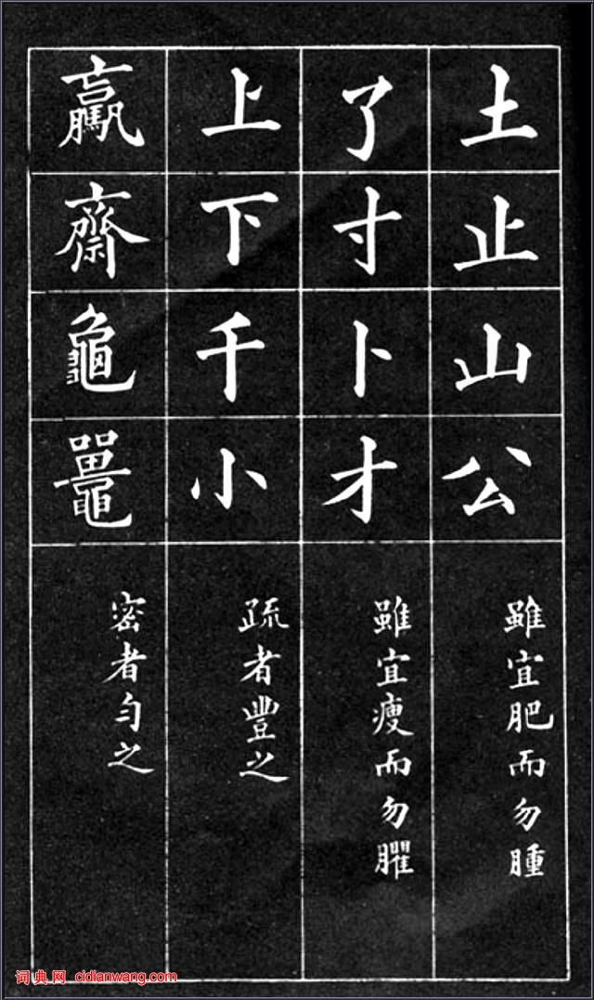

### 65번: 險勁相生 (험경상생)
**원문:** 험준함과 굳셈이 서로 낳는다
**설명:** 险峻与劲健相生，形成力量之美

```
險 (험할 험)
阝+ 僉 ← 위험한 기세
       ← 강한 힘의 조화

구조 분해:
   阝
   ├── 높은 언덕의 험준함
   僉
   └── 모든 힘이 모여 굳센 기운

예시: 峻(높을 준)
   山
   ├── 산의 험준한 모습
   夋
   └── 굳세게 버티는 힘
   
핵심 원리: 대담함과 절제의 균형
```

### 66번: 奇正相生 (기정상생)
**원문:** 기이함과 바름이 서로 낳는다
**설명:** 奇巧与端正相生，避免呆板或怪异

```
奇 (기이할 기)
大 + 可 ← 기이한 변화
        ← 정도의 균형

구조 분해:
   大
   ├── 크고 기이한 형태가
   可
   └── 바른 법도 안에서 변화

예시: 變(변할 변)
   孌
   ├── 복잡하고 기이한 변화
   夂
   └── 기본 원리는 정도를 따름
   
핵심 원리: 창의성과 전통의 조화
```

### 67번: 疏密相間 (소밀상간)
**원문:** 성김과 빽빽함이 서로 사이한다
**설명:** 疏密相间，形成节奏变化和呼吸感

```
間 (사이 간)
門 + 日 ← 성긴 부분과
        ← 빽빽한 부분의 교대

구조 분해:
   門
   ├── 넓게 열린 성긴 공간
   日
   └── 빽빽하게 채운 부분

예시: 闖(들이칠 창)
   門
   ├── 성긴 문 사이로
   馬
   └── 빽빽한 말이 들어감
   
핵심 원리: 리듬감 있는 공간 구성
```

### 68번: 向背相映 (향배상영)
**원문:** 향하고 등짐이 서로 비춘다
**설명:** 向背关系要相互映衬，形成立体感

```
映 (비칠 영)
日 + 央 ← 앞면과 뒷면이
        ← 서로를 비춤

구조 분해:
   日
   ├── 태양이 앞에서 비추고
   央
   └── 중앙에서 뒤를 비춤

예시: 影(그림자 영)
   景
   ├── 경치가 앞에 있고
   彡
   └── 그림자가 뒤에서 비춤
   
핵심 원리: 표면과 이면의 상호 반영
```

---

## 69-72번 서법: 조화와 통일

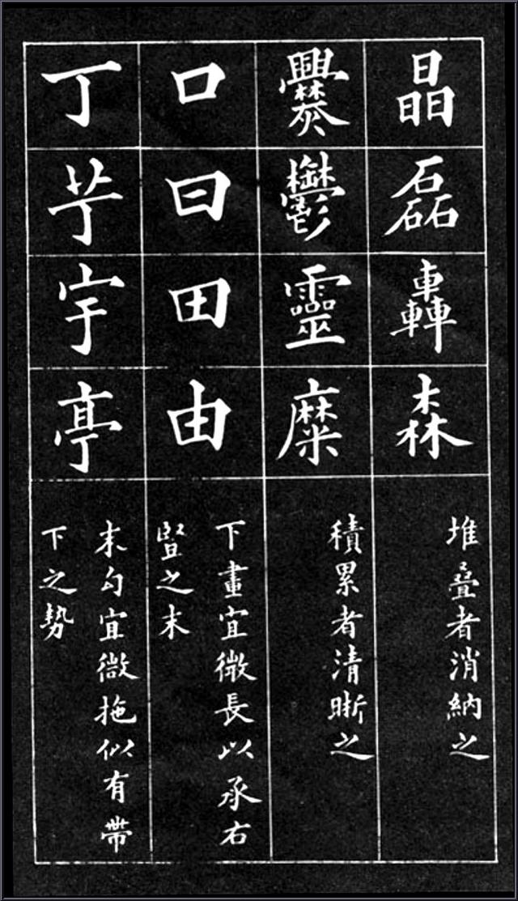

### 69번: 剛柔並濟 (강유병제)
**원문:** 강함과 부드러움이 함께 이루어진다
**설명:** 刚柔并济，阳刚与阴柔相调和

```
剛 (굳을 강)   柔 (부드러울 유)
刀 + 岡       木 + 矛

구조 분해:
剛:           柔:
 刀            木
 ├── 칼의 강함  ├── 나무의 부드러움
 岡            矛
 └── 언덕의 굳음 └── 창의 유연함

예시: 健(건강할 건)
   亻
   ├── 사람의 부드러운 면
   建
   └── 굳센 의지력이 조화
             
핵심 원리: 상반된 성질의 조화로운 공존
```

### 70번: 方圓並施 (방원병시)
**원문:** 모남과 둥굼이 함께 베풀어진다
**설명:** 方圆并用，直线与曲线相结合

```
方 (모날 방)   圓 (둥글 원)
方方方         ○○○

구조 분해:
方:           圓:
 □            ○
직선으로 각진 형태 곡선으로 둥근 형태

예시: 國(나라 국)
   囗
   ├── 네모난 성곽
   或
   └── 둥근 형태의 내부 조화
             
핵심 원리: 직선과 곡선의 적절한 활용
```

### 71번: 藏露並用 (장로병용)
**원문:** 감춤과 드러냄이 함께 쓰인다
**설명:** 藏锋露锋并用，含蓄与显露相结合

```
藏 (감출 장)   露 (이슬 로)
艹 + 臧       雨 + 路

구조 분해:
藏:           露:
 艹            雨
 ├── 풀에 감춤  ├── 비에 드러남
 臧            路
 └── 내부 숨김  └── 길 위 노출

예시: 含(머금을 함)
   今
   ├── 지금 드러나는 부분
   口
   └── 입 속에 감춘 부분
             
핵심 원리: 명시와 암시의 균형잡힌 활용
```

### 72번: 巧拙並陳 (교졸병진)
**원문:** 교묘함과 졸박함이 함께 진열된다
**설명:** 巧拙并陈，精巧与朴拙相得益彰

```
巧 (교묘할 교) 拙 (졸할 졸)
工 + 丂       手 + 出

구조 분해:
巧:           拙:
 工            手
 ├── 정교한 기술 ├── 서툰 손놀림
 丂            出
 └── 교묘한 구부림 └── 단순한 직진

예시: 樸(박달나무 박)
   木
   ├── 나무의 소박함
   菐
   └── 자연스러운 교묘함이 조화
             
핵심 원리: 기교와 순박함의 조화
```

---

## 73-76번 서법: 완성도와 표현

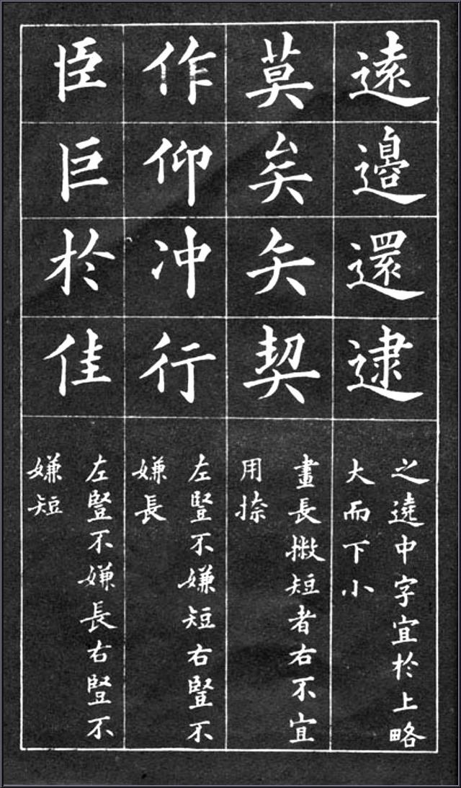

### 73번: 肥瘦適中 (비수적중)
**원문:** 살찌고 마름이 적당히 중간이다
**설명:** 笔画肥瘦要适中，不可过肥或过瘦

```
適 (적당할 적)
辶 + 啻 ← 너무 굵지도 얇지도 않게
        ← 적절한 굵기 유지

구조 분해:
   辶
   ├── 길을 걸으며 조절하고
   啻
   └── 적당한 상태에 도달

예시: 中(가운데 중)
   口
   ├── 네모 틀 안에서
   丨
   └── 굵지도 얇지도 않은 중심선
   
핵심 원리: 과도함과 부족함을 피한 적절함
```

### 74번: 長短適中 (장단적중)
**원문:** 길고 짧음이 적당히 중간이다
**설명:** 笔画长短要适中，符合字体的自然比例

```
中 (가운데 중)
口 + 丨 ← 과장되지 않고
        ← 축소되지도 않게

구조 분해:
   口
   ├── 적당한 크기의 틀
   丨
   └── 알맞은 길이의 중심선

예시: 正(바를 정)
   一
   ├── 적당한 길이의 상단
   止
   └── 적절한 크기의 하단
   
핵심 원리: 자연스러운 비례감 유지
```

### 75번: 收放適度 (수방적도)
**원문:** 거두고 놓음이 적당한 정도다
**설명:** 收放要有度，既不拘谨也不放纵

```
度 (도 도)
广 + 廿 + 又 ← 긴장과 이완의
            ← 적절한 조절

구조 분해:
   广
   ├── 집 안에서 거두어들이고
   廿又
   └── 손으로 적당히 놓아줌

예시: 張(칠 장)
   弓
   ├── 활을 당겨 긴장시키고
   長
   └── 적절히 풀어 놓음
   
핵심 원리: 역동성과 안정성의 균형
```

### 76번: 開合適宜 (개합적의)
**원문:** 열고 닫음이 적당히 마땅하다
**설명:** 开合要适宜，疏密得当形成呼吸感

```
宜 (마땅할 의)
宀 + 且 ← 개방과 폐쇄가
        ← 상황에 맞게 조절

구조 분해:
   宀
   ├── 집의 열고 닫는 지붕
   且
   └── 상황에 맞는 적절한 조절

예시: 閉(닫을 폐)
   門
   ├── 문을 적당히 열고
   才
   └── 때에 맞춰 닫음
   
핵심 원리: 상황에 맞는 유연한 대응
```

---

## 77-80번 서법: 정신과 기운

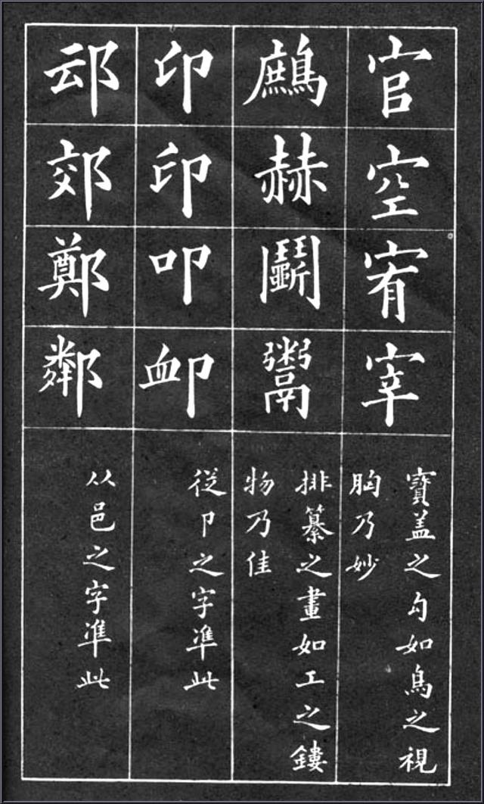

### 77번: 精神專注 (정신전주)
**원문:** 정신을 오로지 모은다
**설명:** 书写时精神要专注，心无旁骛方能入神

```
專 (오로지 전)
専 ← 하나의 목표에
   ← 모든 에너지 집중

구조 분해:
   叀
   ├── 실을 한 곳에 모으고
   寸
   └── 손으로 정확히 집중

예시: 一(하나 일)
   一
   └── 모든 에너지가 하나의 선에 집중
   
핵심 원리: 분산되지 않는 일점 집중
```

### 78번: 氣韻生動 (기운생동)
**원문:** 기운과 운치가 생동한다
**설명:** 气韵生动，字里行间要有生命活力

```
動 (움직일 동)
重 + 力 ← 생명력 있는
        ← 자연스러운 움직임

구조 분해:
   重
   ├── 무게감 있는 움직임
   力
   └── 힘이 살아 숨쉬는 기운

예시: 龍(용 룡)
   龍
   └── 용이 하늘을 날듯 역동적 생명력
   
핵심 원리: 정적 형태에 담긴 역동적 생명력
```

### 79번: 骨力雄健 (골력웅건)
**원문:** 골격의 힘이 웅장하고 건실하다
**설명:** 字的骨架要雄健有力，如同英雄之骨

```
健 (건강할 건)
亻+ 建 ← 튼튼한 골격
       ← 내재된 강인함

구조 분해:
   亻
   ├── 사람의 기본 골격
   建
   └── 견고하게 세워진 구조

예시: 立(설 립)
   立
   └── 땅에 굳게 서있는 골격의 힘
   
핵심 원리: 외형을 지탱하는 내적 힘
```

### 80번: 筋肉豐滿 (근육풍만)
**원문:** 근육이 풍성하고 충만하다
**설명:** 字的血肉要丰满，不可枯瘦单薄

```
豐 (풍성할 풍)
豆 + 豊 ← 충실한 형태
        ← 여유있는 표현

구조 분해:
   豆
   ├── 콩처럼 알찬 윗부분
   豊
   └── 풍성하게 차오른 아래부분

예시: 豐(풍성할 풍)
   豐
   └── 곡식이 가득 차서 풍만한 모습
   
핵심 원리: 빈약하지 않은 충실한 표현
```

---

## 81-84번 서법: 완성과 마무리

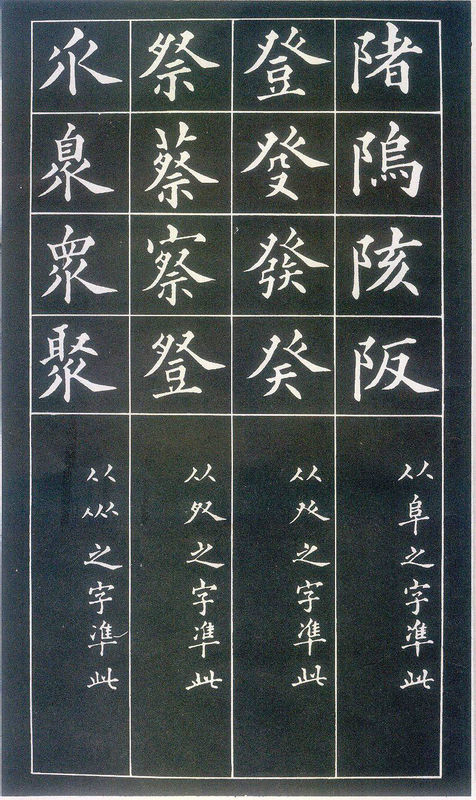

### 81번: 首尾呼應 (수미호응)
**원문:** 머리와 꼬리가 서로 호응한다
**설명:** 字的首尾要相呼应，形成完整统一感

```
首 (머리 수)   尾 (꼬리 미)
首首首        尸 + 毛

구조 분해:
首:           尾:
 首            尸
 ├── 머리의    ├── 몸의 끝
 목            毛
 └── 시작      └── 꼬리털로 마무리

예시: 龍(용 룡)
   머리에서 시작하여 꼬리까지
   하나의 완전한 생명체로 호응
             
핵심 원리: 시작과 끝의 유기적 연결
```

### 82번: 上下貫通 (상하관통)
**원문:** 위아래가 꿰뚫어 통한다
**설명:** 上下结构要贯通一气，不可断裂分离

```
貫 (꿰뚫을 관)
毌 + 貝 ← 상하가 하나의
        ← 일관된 흐름으로

구조 분해:
   毌
   ├── 위에서 시작하여
   貝
   └── 아래까지 일관되게 관통

예시: 串(꿸 천)
   │
   ├── 하나의 축이
   口口
   └── 상하를 완전히 관통
   
핵심 원리: 상하 구조의 완전한 통합
```

### 83번: 左右呼應 (좌우호응)
**원문:** 좌우가 서로 호응한다
**설명:** 左右结构要相互呼应，保持平衡协调

```
應 (응할 응)
广 + 䧹 ← 좌우 부분이
        ← 서로 반응함

구조 분해:
   广
   ├── 왼쪽이 부르면
   䧹
   └── 오른쪽이 응답함

예시: 羽(깃털 우)
   羽
   ├── 왼쪽 깃털
   羽
   └── 오른쪽 깃털이 대칭 호응
   
핵심 원리: 좌우 균형을 통한 안정감
```

### 84번: 整體和諧 (정체화해)
**원문:** 전체가 화목하고 조화롭다
**설명:** 整体要和谐统一，各部分融为一体

```
和 (화할 화)   諧 (화할 해)
禾 + 口       言 + 皆

구조 분해:
和:           諧:
 禾            言
 ├── 곡식과    ├── 말과
 口            皆
 └── 입이 조화  └── 모든 것이 조화

예시: 樂(즐거울 락)
   白
   ├── 모든 요소가
   木
   └── 완전한 조화를 이룸
             
핵심 원리: 모든 요소의 완전한 조화
```

---

## 85-88번 서법: 최종 완성


### 85번: 神采飛揚 (신채비양)
**원문:** 신령스러운 빛채가 날아오른다
**설명:** 字要有神采飞扬之势，如凤凰展翅

```
飛 (날 비)     揚 (날릴 양)
飛飛飛         手 + 昜

구조 분해:
飛:           揚:
 飛            手
 ├── 새가      ├── 손으로
 날개짓하며    昜
 └── 하늘로    └── 높이 날림

예시: 鳳(봉황 봉)
   鳳
   └── 봉황이 하늘로 날아오르는 신령함
             
핵심 원리: 정신적 고양감의 시각적 표현
```

### 86번: 意趣盎然 (의취앙연)
**원문:** 뜻과 취향이 가득하다
**설명:** 字要意趣盎然，充满生机与情趣

```
盎 (가득할 앙)
皿 + 央 ← 충만한 의미와
        ← 풍부한 정취

구조 분해:
   皿
   ├── 그릇에 가득 담긴
   央
   └── 중심되는 깊은 뜻

예시: 意(뜻 의)
   音
   ├── 소리에 담긴 의미
   心
   └── 마음 가득한 뜻
   
핵심 원리: 형태를 넘어선 풍부한 내용
```

### 87번: 境界高遠 (경계고원)
**원문:** 경지가 높고 멀다
**설명:** 书法境界要高远，追求超凡脱俗之美

```
高 (높을 고)   遠 (멀 원)
高高高         辶 + 袁

구조 분해:
高:           遠:
 高            辶
 ├── 높은      ├── 길을 따라
 경지          袁
 └── 도달      └── 멀리 나아감

예시: 峰(봉우리 봉)
   山
   ├── 산의 높은 봉우리처럼
   峯
   └── 도달하기 어려운 높은 경지
             
핵심 원리: 높은 예술적 경지 도달
```

### 88번: 造詣精深 (조예정심)
**원문:** 조예가 정밀하고 깊다
**설명:** 书法造诣要精深，达到炉火纯青之境

```
精 (정밀할 정) 深 (깊을 심)
米 + 青        氵+ 深

구조 분해:
精:           深:
 米            氵
 ├── 쌀알     ├── 물이
 처럼 정밀    깊숙이
 青            深
 └── 푸르게   └── 파고듦

예시: 淵(못 연)
   氵
   ├── 물이 깊고
   淵
   └── 바닥을 알 수 없는 깊이
             
핵심 원리: 깊이 있는 예술적 완성도
```

---

## 89-92번 서법: 궁극의 경지

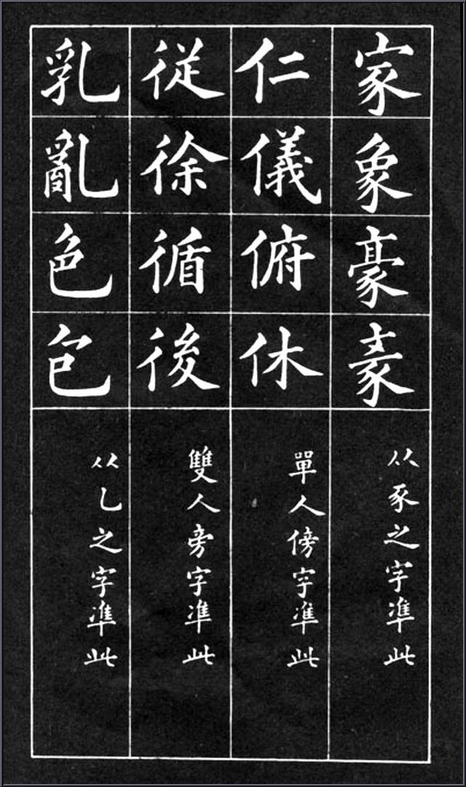

### 89번: 渾然天成 (혼연천성)
**원문:** 혼연히 하늘이 이루어준 것 같다
**설명:** 字要浑然天成，如天工自然造化

```
天 (하늘 천)   成 (이룰 성)
一 + 大        戈 + 丁

구조 분해:
天:           成:
 一            戈
 ├── 하늘의    ├── 창으로
 넓은 품       완성을
 大            丁
 └── 큰 포용   └── 못으로 고정

예시: 自(스스로 자)
   自
   └── 스스로 자연스럽게 완성된 모습
             
핵심 원리: 인위적이지 않은 자연스러운 완성
```

### 90번: 爐火純青 (로화순청)
**원문:** 화로의 불이 순수하고 푸르다
**설명:** 技艺达到炉火纯青，登峰造极之境

```
純 (순수할 순) 青 (푸를 청)
糸 + 屯        青青青

구조 분해:
純:           青:
 糸            生
 ├── 실이      ├── 생명이
 순수하게      푸르게
 屯            丹
 └── 모여있음  └── 단순 명료

예시: 精(정수 정)
   米
   ├── 쌀의 정수처럼
   青
   └── 맑고 순수한 상태
             
핵심 원리: 최고 수준의 순수한 기예
```

### 91번: 出神入化 (출신입화)
**원문:** 신묘함에서 나와 조화에 들어간다
**설명:** 超越技巧，达到出神入化的艺术境界

```
神 (신령 신)   化 (변할 화)
示 + 申        亻+ 匕

구조 분해:
神:           化:
 示            亻
 ├── 신이      ├── 사람이
 보여주는      변화
 申            匕
 └── 신묘함    └── 새로운 형태로

예시: 變(변할 변)
   孌
   ├── 복잡한 변화 속에서
   夂
   └── 신묘한 완성에 도달
             
핵심 원리: 기예가 신의 경지에 도달
```

### 92번: 登峰造極 (등봉조극)
**원문:** 봉우리에 올라 극에 이른다
**설명:** 书法艺术登峰造极，达到最高境界

```
峰 (봉우리 봉) 極 (극한 극)
山 + 峯        木 + 及

구조 분해:
峰:           極:
 山            木
 ├── 산의      ├── 나무가
 최고봉        끝까지
 峯            及
 └── 정상      └── 도달함

예시: 至(이를 지)
   一
   ├── 하늘에서 시작하여
   土
   └── 땅의 극한까지 도달
             
핵심 원리: 예술의 최고 정점 도달
```

---

## 결론

황자원의 간가결구 구십이법은 중국 서예의 구조적 원리를 체계적으로 정리한 고전 이론입니다. 각 서법은 단순한 기술적 규칙을 넘어서 서예의 미학적, 철학적 깊이를 담고 있습니다.

이 92가지 법칙들은 서로 독립적이면서도 상호 보완적인 관계를 이루며, 전체적으로는 완전한 서예 교육 체계를 구성합니다. 기초적인 구조 원리부터 시작하여 고급 기법과 정신적 경지에 이르기까지, 단계적이고 체계적인 학습 과정을 제시합니다.

서예 학습자들은 이 법칙들을 통해 글자의 균형감, 비례감, 그리고 생동감 있는 표현력을 기를 수 있으며, 궁극적으로는 기법을 넘어선 예술적 경지에 도달할 수 있습니다.

---

*본 문서는 황자원의 간가결구 구십이법을 현대적 관점에서 해석하고 정리한 것입니다.*